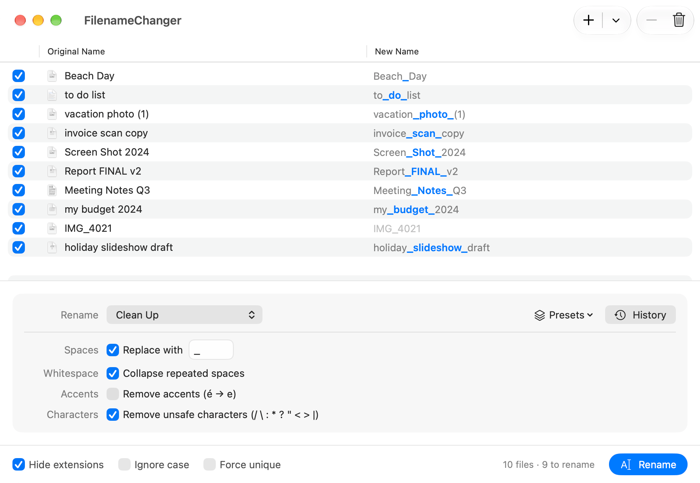

<div align="center">


# FilenameChanger

**Batch-rename hundreds of files at once, see every new name before
anything moves, and undo the whole lot with ⌘Z.**

[](https://github.com/bensquire/FilenameChanger/actions/workflows/ci.yml)
[](https://github.com/bensquire/FilenameChanger/actions/workflows/release.yml)
[](https://github.com/bensquire/FilenameChanger/releases/latest)
[](https://www.apple.com/macos/)
[](https://swift.org)

[**Download latest →**](https://github.com/bensquire/FilenameChanger/releases/latest) ·
[Releases](https://github.com/bensquire/FilenameChanger/releases)

<br/>



</div>

Drop in some files or a folder, pick a rename function, and the **New Name**
column shows the result for every file as you type. The part that changes is
highlighted. Rows that would collide are flagged, and nothing touches the disk
until you press **Rename**.

FilenameChanger recreates MRR Software's
[NameChanger](https://mrrsoftware.com/namechanger/) as a native SwiftUI app
for Apple Silicon. It is small, has no dependencies, and works offline.

## Rename functions

Thirteen functions. Each one previews live, and a row the function doesn't
match is simply left alone.

| Function | What it does | Example |
|---|---|---|
| **Prepend** / **Append** | Adds text to the start or the end | `notes` → `2026-notes` |
| **Replace First / Last / All** | Replaces the first, last or every occurrence of some text | `-` → `_`: `a-b-c` → `a_b-c` / `a-b_c` / `a_b_c` |
| **Wildcard** | Finds with `*` and `?`, replaces with literal text | `draft-??` → `final`: `report draft-03` → `report final` |
| **Regular Expression** | A full regex, with `$1` back-references | `(\d+)-(\w+)` → `$2-$1`: `07-notes` → `notes-07` |
| **Remove Characters** | Removes a range, or the last N characters | last 6: `report_draft` → `report` |
| **Insert Characters** | Inserts at an index or at the end, optionally padding to a length | pad to 3 with `0`: `7` → `007` |
| **Change Case** | Title, lower, UPPER, `snake_case`, `kebab-case`, `camelCase`, `PascalCase`, `SCREAMING_SNAKE` | `My File` → `my-file` |
| **Clean Up** | Replaces spaces, collapses whitespace, strips accents and removes unsafe characters (`/ \ : * ? " < > \|`) | `Café  Menu?` → `Cafe_Menu` |
| **Sequence** | Numbers files (1–6 digits, any start) with optional text before or after the number. Prepend, append or replace. Ordered by your custom order, name, file date or EXIF date | `IMG_4021` → `Trip 001` |
| **Date** | Stamps a chosen date, the file's creation date or its EXIF date, from six presets or a custom pattern. Prepend, append or replace | `IMG_4021` → `2026-10-25` |

### Options

- **Hide extensions** (on by default): functions only see the base name, so
  `photo.jpg` keeps its `.jpg` whatever you do to `photo`.
- **Ignore case**: Replace, Wildcard and Regex match regardless of case.
- **Force unique**: a name that would collide gets ` 1`, ` 2`, … added before
  the extension, so it isn't skipped.

## Safe by design

- **Preview first.** Every new name is computed before anything moves. Grey
  rows with a ⚠️ show what will be skipped and why: the name is already taken,
  two files want the same name, or the name is invalid or empty.
- **Chained renames just work.** A shift (`1→2, 2→3, 3→4`), a swap (`a↔b`) or a
  rotation is routed through a temporary name, so it isn't refused or
  clobbered.
- **All or nothing.** If any file in a batch can't be moved, the files already
  moved are put back. If one can't be put back, FilenameChanger tells you
  exactly where it was left.
- **Never overwrites.** An existing file is never replaced, and case-only
  renames (`photo` → `PHOTO`) work on case-insensitive volumes.
- **⌘Z undoes the whole batch**, and ⇧⌘Z redoes it.
- **Hidden files are skipped.** `.DS_Store` and hidden folders are never
  queued. A file added twice, even through a symlink, appears once.
- **Settings are never lost.** A presets or history file that can't be read is
  kept as a `.bak`, not thrown away.

## Working with files

- **Add files** with the **+** button: pick files, a folder's contents, or a
  folder's contents recursively. You can also drag from Finder onto the
  window. Packages such as `.app` bundles are added whole.
- **From Finder**: right-click files ▸ Open With ▸ **FilenameChanger**, drop
  them on the Dock icon, or use right-click ▸ Services ▸ **Rename with
  FilenameChanger**. A folder brings in the files inside it.
- **Quick Look**: press space in the file list to preview the selected file,
  as in Finder.
- **Drag to reorder** rows. This order is the one a custom-sorted Sequence
  numbers against.
- **Tick or untick** a row to include or skip it.
- **Right-click a row** to rename that one file by hand, reveal it in Finder,
  or remove it from the list.
- **Presets** save the current function and its settings by name, so you can
  reapply them in one click.
- **History** logs your last 50 rename batches, old name → new name.
- **Everything is in the File menu** too: adding files, Rename, presets and
  History.

| Shortcut | Action |
|---|---|
| ⌘O | Add files |
| ⌘↩ | Rename |
| Space | Quick Look the selection |
| ⌘Z / ⇧⌘Z | Undo / redo the last batch |

## Install

1. [Download the latest DMG](https://github.com/bensquire/FilenameChanger/releases/latest).
2. Drag **FilenameChanger** into **Applications**.
3. Launch it. Release builds are signed and notarized by Apple.

## Build from source

SwiftPM, no Xcode project, no third-party dependencies. It needs macOS 26 and
Xcode 26 (Swift 6.2).

```sh
git clone https://github.com/bensquire/FilenameChanger.git
cd FilenameChanger
CODESIGN_IDENTITY=- ./bundle.sh   # ad-hoc signed FilenameChanger.app
open FilenameChanger.app
```

Without `CODESIGN_IDENTITY`, `bundle.sh` signs with your Developer ID.

## Development

```sh
swift build                   # debug build
swift run FilenameChanger     # run unbundled
make test                     # the Swift Testing suites
make lint                     # Apple swift-format, strict
make format                   # rewrite in place
make bundle                   # build FilenameChanger.app
```

`FILENAMECHANGER_FOLDER=/path/to/folder swift run FilenameChanger` loads that
folder's files at launch, so you can skip the open panel while iterating.

Enable the pre-commit hook (lint + tests) with:

```sh
git config core.hooksPath .githooks
```

### Project layout

```
Sources/RenameKit/                 # the engine: pure Swift, no AppKit
  RenameFunction.swift             #   the thirteen functions, one enum case each
  RenameEngine.swift               #   plan: split extension, apply, flag collisions
  RenameSequencer.swift            #   orders moves so chains and swaps go via temps
  TextMatching.swift               #   find/replace, wildcard and cached regex
  SystemFileMetadataProvider.swift #   file dates + EXIF via ImageIO
Sources/RenameApp/                 # SwiftUI views and the @Observable AppModel
  AppModel.swift                   #   state, live plan, transactional rename, undo
  ContentView.swift                #   file table, toolbar, options bar
  FunctionParametersView.swift     #   per-function controls
  FileAdder.swift                  #   open panel, drops and folder expansion
  Persistence.swift                #   presets + history as JSON in Application Support
  AppDelegate.swift                #   composition root; Open With, Dock drops, the Service
  FileCommands.swift               #   the File menu
Sources/FilenameChanger/           # @main entry point
Tests/FilenameChangerTests/        # Swift Testing: every function, the engine,
                                   #   and real renames on disk in temp folders
icon/                              # programmatic icon generator
scripts/                           # Info.plist template, DMG packaging
```

`RenameKit` doesn't import AppKit and reads file metadata through an injected
protocol, so the engine tests run against a fake. `RenameApp` is a library
rather than part of the executable, so the model can be tested too.

## Releasing

Releases are cut by tag. Pushing a `v*` tag makes CI build, sign, notarize and
staple the app and a DMG, then publish a GitHub Release:

```sh
git tag v0.1.0
git push --tags
```

A `vX.Y.Z-something` tag (e.g. `v0.2.0-rc1`) publishes as a prerelease.
Locally, `make release` builds a signed DMG, and notarizes it when the
`paperdrop` notarytool keychain profile exists.
